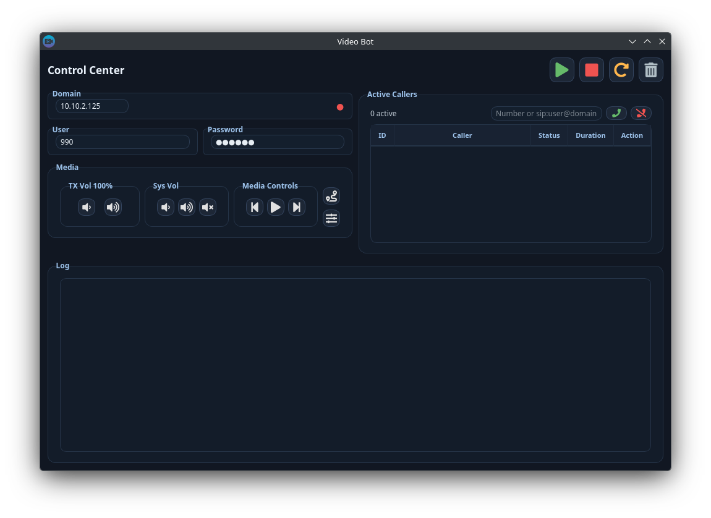

# SIP Echo Bot

Linux desktop application (PySide6 + baresip) that answers SIP calls and echoes received video/audio back, with a GUI for configuration and call monitoring.



## Features
- Answers incoming SIP calls with video
- Echoes received video frames back to caller
- Audio loopback (media playback or system capture)
- GUI for SIP credentials, audio/video settings, media management
- Call hangup on new incoming call (stale call cleanup)

## Quick Start
```bash
./run.sh
```
The launcher creates `$HOME/.venv`, installs dependencies, builds baresip-python, and starts the app.

## Build Dependencies
```bash
./build_baresip_python.sh
```

## Requirements
- Manjaro/Arch or Ubuntu/Debian
- Python 3.12+ (via uv)
- FFmpeg, x264, v4l2
- PySide6, QtAwesome, evdev, cffi, numpy

## License
MIT
